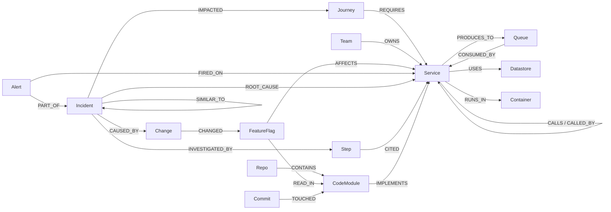

# RootCause

An AI on-call agent for the OpenTelemetry Demo shop. It turns live traces and metrics into a **FalkorDB** graph,
finds the one real cause behind a storm of symptom alerts, proves it with an evidence path, fixes it with human
approval, verifies recovery, writes the report and remembers the incident.

**Track:** Graph Hacks: Context for AI Agents (WeMakeDevs × FalkorDB) — *Agents That Act on Connected Data*
**Demo video:** _TODO: add YouTube link_ · **Live (replay) deployment:** http://3.234.90.242/ (AWS, replay mode — see [docs/DEPLOY.md](docs/DEPLOY.md))

## Start here (judges, 5 minutes)
- **Watch** the demo video (link above): 4 minutes, one real run on the official OpenTelemetry Demo, from a bad
  config change to a pull request merged by a person.
- **Try** http://3.234.90.242/ and click **Start demo**: a replay of a real run that tells the story by itself.
- **Read** [How it works](#how-it-works) (one diagram, nine steps) and [Why a graph](#why-a-graph).

| Track 01 focus | Where RootCause does it |
|---|---|
| Multi-hop reasoning | The evidence path walks `BLAMES` edges from the website gateway to the cause (`shortestPath`, up to 8 hops); impact walks `Journey -REQUIRES-> Service`; the code layer joins `CodeModule -IMPLEMENTS-> Service -CALLS-> Service`. |
| Graph queries and algorithms as agent tools | 16 MCP tools, each backed by named Cypher queries: `algo.WCC` (one incident), `algo.pageRank` (where blame flows), `shortestPath` (proof), `algo.bfs` (blast radius), `algo.betweenness` (restart risk), plus a guarded read-only Cypher tool. |
| Tool selection through MCP | The Gemini agent chooses which tools to call on our MCP server; every call is stored as a `(:Step)` that `CITED` the nodes it used. Any MCP client (e.g. Claude Desktop) can use the same tools. |
| Actions based on what the graph shows | Revert the flag that `AFFECTS` the root; judge a restart by blast radius and centrality; page the team that `OWNS` it; open a pull request on the file where the root reads the flag (`READ_IN`). Every action needs a person's approval. |
| Explainable results | Evidence path on the map, the reasoning in plain words, cited node ids, a report written from the graph, and a blind scorecard with every miss listed. |
| Remember, connect people and decisions | Incident memory (`SignalPattern` overlap → the fix that worked), teams, on-call people, runbooks, approved actions and pull requests, all in the same graph. |

Architecture diagram and how each part works: [docs/ARCHITECTURE.md](docs/ARCHITECTURE.md). Picking this up? Start with [HANDOFF.md](HANDOFF.md).


> Status (18 Oct 2026): acceptance checks M0–M11 pass against the real OpenTelemetry Demo (M8: MCP verified with an
> MCP client). The Gemini agent and *Fix it in code* ran live: RootCause opened pull requests on our fork of the demo
> and a person merged them (yash4428/opentelemetry-demo #2 and #4). Every catalogue fault was broken by hand
> (observations in [chaos/catalogue.yaml](backend/rootcause/chaos/catalogue.yaml)); 7 recorded scenarios replay to the
> right cause in CI; 207 tests run against a real FalkorDB. Evidence: [docs/PROGRESS.md](docs/PROGRESS.md).
> Feature list with status: [docs/FEATURES.md](docs/FEATURES.md).

## How it works


1. **The shop**: the official OpenTelemetry Demo (agentic mode) with a load generator, on our laptop.
2. **Collector**: one extra exporter sends a copy of every trace to RootCause (`infra/otelcol-config-extras.yml`).
3. **Ingest, every 5 s**: spans become `CALLS`, queues, datastores and customer journeys; plus Prometheus metrics,
   Docker CPU/memory, container restarts and flag changes.
4. **FalkorDB**: the single source of truth. Services, baselines, alerts, incidents, changes, teams, code, agent
   steps, memory, reports and pull requests are all nodes and edges.
5. **Detector**: EWMA baselines on the graph; alert rules mark nodes `:Anomalous`.
6. **Engine**: BLAMES edges, `algo.WCC` grouping, ranking with `algo.pageRank`, `shortestPath` evidence, impact, risk.
7. **Agent**: Gemini picks from 16 tools on our MCP server (or the no-LLM autopilot runs the same steps); every call
   is a `(:Step)` citing the nodes it used.
8. **Actions**: safest fix first; nothing runs without a person's approval (single-use token).
9. **You**: company map + chat, verified recovery, the incident report, and the code fix as a GitHub pull request.

## Why a graph
Many alerts → one incident is a **connected-components** question (`algo.WCC` over BLAMES). "Who is to blame" is
**PageRank** over BLAMES plus depth. "What else breaks" is **BFS** upstream over CALLED_BY. "How risky is a restart" is
**betweenness**. "Have we seen this before" is **Jaccard** over shared SignalPatterns. Remove FalkorDB and none of
these work — the graph is the engine's state, not a cache.

## Connect your GitHub
Paste a public repository URL in the **Codebase** tab. RootCause makes a shallow clone and reads it (it never runs
it) into the same graph: which folder `IMPLEMENTS` which service, what it `DECLARES` it depends on (compose
`depends_on`, `*_ADDR` env vars), gRPC services from `.proto` files, where each feature flag is `READ_IN` (file:line)
and the latest commits per module. During an incident the chat then shows the code behind the root cause, e.g.
*"Flag paymentFailure is read at src/payment/charge.js:40"*, and the agent's `read_code` step cites the module.
`code_drift` compares the declared dependencies with the calls seen live. The code explains; it never changes
the ranking. The public site scans only the official OpenTelemetry Demo repo (`code.allowed_repos`).

## Fix it in code (pull requests)
After an incident is fixed and verified, RootCause can also fix it **in the code**. It finds the file where the
root-cause service reads the flag that broke it (from the scanned repo), asks Gemini for a small find/replace fix,
applies it only if every edit matches exactly once, and opens a **GitHub pull request** on our fork (`RC_PR_REPO`).
The PR description carries the evidence path, the change and the customer impact from the graph, and the PR is
recorded as `(:PullRequest)-[:FIXES]->(:Incident)`. It needs a human approval like every action, opens at most one
PR per 10 minutes, never merges, and says plainly that RootCause did not run the changed code. Needs
`GEMINI_API_KEY`, `GITHUB_TOKEN` (fine-grained, the fork only) and `RC_PR_REPO`.

## Make it yours
RootCause learns the service graph from telemetry on its own. The **Your company** tab (or `config/seed.yaml`) adds
what only your company knows, stored as graph edges: `(:Team)-[:OWNS]->(:Service)` and on-call people (who gets
paged), `(:Journey)` routes (business impact) and `(:Runbook)-[:FOR]->(:Service)` with an optional **automation
URL** (a webhook to your own script or workflow, proposed as a fix with its declared risk and run only after
approval). Export the setup back to seed.yaml with one click.

## Quick start — live mode (needs Docker, ~8 GB RAM)
```bash
cp .env.example .env            # add GEMINI_API_KEY to use the LLM agent (optional)
make demo-up                    # clones the OpenTelemetry Demo to ../opentelemetry-demo, installs our collector override,
                                # sets LOCUST_USERS=12 in its .env.override, starts agentic mode
make up                         # FalkorDB (:6380, browser :3300), API (:8000, OTLP :4318), MCP (:8811), UI (:8088)
make seed                       # indexes + teams, people, journeys, runbooks
open http://localhost:8088      # wait ~3 min while baselines are learned
```
Then go to **Chaos lab → Break it**, or from a terminal:
`uv run python scripts/acceptance_check.py --flag paymentFailure --approve` (flips the flag, prints the alert timeline,
the incident, evidence path and proposals, approves the fix and waits for verified recovery).

Notes from running it for real: the demo's default 5 load-generator users give checkout only ~2 requests/min, too few
for 60 s detection windows, so `make demo-up` raises `LOCUST_USERS` to 12 (the demo's own knob). Keep the laptop awake
and plugged in — a sleeping Mac pauses the Docker VM. `POST /api/admin/reset` gives a fresh graph (re-learns baselines).

Development without containers for the API: `uv sync && PYTHONPATH=backend uv run python -m rootcause.api` with
`FALKORDB_HOST=localhost FALKORDB_PORT=6380`; UI: `make ui` (Vite on :5173, proxies `/api` to :8000).

## Quick start — replay mode (no demo needed)
```bash
make replay-up                  # FalkorDB + API (RC_MODE=replay) + UI on :8088
open http://localhost:8088      # the healthy part fast-forwards, the fault plays live; approve the fix to see recovery
```
Recordings live in `replay/*.jsonl.gz` and are made from the live demo with `make record SCENARIO=paymentFailure`.

## Graph data model
Full tables: [docs/GRAPH_MODEL.md](docs/GRAPH_MODEL.md).



| Nodes | Service, Queue, Datastore, Container, Journey, Team, Person, Runbook, FeatureFlag, Change, Alert, Incident, SignalPattern, Hypothesis, Action, Prediction, Step, Report, ChaosRun, Repo, CodeModule, RpcService, Commit, PullRequest (+ dynamic `:Anomalous`) |
|---|---|
| **Edges** | CALLS, CALLED_BY, PRODUCES_TO, CONSUMED_BY, USES, RUNS_IN, REQUIRES, OWNS, MEMBER_OF, FOR, REMEDIATES, AFFECTS, CHANGED, FIRED_ON, PART_OF, BLAMES (transient), ROOT_CAUSE, CAUSED_BY, IMPACTED, RESOLVED_BY, HAS_SIGNAL, SIMILAR_TO, HAS_REPORT, HAS_HYPOTHESIS, INVESTIGATED_BY, NEXT, CITED, PREDICTS, PRODUCED, CONTAINS, IMPLEMENTS, DECLARES, SERVES, READ_IN, TOUCHED, FIXES, CHANGES |

## Queries and algorithms we depend on
All 102 queries are named `.cypher` files in [backend/rootcause/graph/queries/](backend/rootcause/graph/queries/), listed
with their purpose in [docs/QUERIES.md](docs/QUERIES.md). The core ones:

| Query | Algorithm | Purpose |
|---|---|---|
| [rebuild_blames](backend/rootcause/graph/queries/rebuild_blames.cypher) | – | BLAMES between anomalous nodes |
| [group_incidents](backend/rootcause/graph/queries/group_incidents.cypher) | `algo.WCC` | many alerts → one incident |
| [pagerank_blame](backend/rootcause/graph/queries/pagerank_blame.cypher) | `algo.pageRank` | where blame flows |
| [evidence_path](backend/rootcause/graph/queries/evidence_path.cypher) | `shortestPath` | the evidence chain |
| [upstream_bfs](backend/rootcause/graph/queries/upstream_bfs.cypher) | `algo.bfs` | blast radius, prediction |
| [service_betweenness](backend/rootcause/graph/queries/service_betweenness.cypher) | `algo.betweenness` | restart risk |
| [code_for_node](backend/rootcause/graph/queries/code_for_node.cypher) | – | the code behind the root cause (module, flag reads, commits) |
| [code_drift](backend/rootcause/graph/queries/code_drift.cypher) | – | calls seen live vs dependencies the repo declares |
| [similar_incidents](backend/rootcause/graph/queries/similar_incidents.cypher) | Jaccard over HAS_SIGNAL | incident memory |
| [recent_changes_for](backend/rootcause/graph/queries/recent_changes_for.cypher) | – | flag changes that AFFECT a node |

## Scorecard
Blind chaos runs on the live demo (`make chaos N=15`): the harness flips a random catalogue flag, the engine is not
told, and the settled verdict is scored against the catalogue truth, next to simple baselines on the same alerts.
Full table, per-class breakdown and every miss: [docs/SCORECARD.md](docs/SCORECARD.md) (copied below by
`scripts/sync_readme_scorecard.py`, never typed).

<!-- scorecard:start -->
15 blind chaos runs. Generated by `make chaos`; do not edit by hand. Every method is scored on the same alert snapshot; a run with no incident is a miss for every method.

| method | top-1 | top-3 | median time to verdict | runs scored |
|---|---|---|---|---|
| rootcause | 80% | 80% | 50 s | 15 |
| graph_off | 73% | 80% | - | 15 |
| llm_no_graph | 80% | 87% | - | 15 |
| loudest_alert | 53% | 73% | - | 15 |
| first_alert | 60% | 73% | - | 15 |
| highest_error | 53% | 80% | - | 15 |

## RootCause top-1 by fault class

| class | top-1 | runs |
|---|---|---|
| ai | 100% | 1 |
| errors | 86% | 7 |
| invisible | 67% | 6 |
| latency | 100% | 1 |

## Misses

- `recommendationCacheFailure` (truth `recommendation`): verdict `frontend` — truth not among candidates (top-1 was frontend)
- `adFailure` (truth `ad`): verdict `agent` — truth not among candidates (top-1 was agent)
- `kafkaConsumerDead` (truth `fraud-detection`): verdict `astronomy-db` — truth not among candidates (top-1 was astronomy-db)
<!-- scorecard:end -->

Reading it (from the per-run results in the `rc_eval_20261018_073532` graph): RootCause and Gemini given only a flat
table of the same alerts both named the cause first in 12 of 15 runs, but not the same 12. Only RootCause found the
broken connection in `paymentUnreachable` (`edge:checkout->payment`; Gemini blamed checkout). Gemini found one
`recommendationCacheFailure` where recommendation raised no alert of its own. All three RootCause misses are faults
whose true service never alerted. RootCause's answer also carries the evidence path, the change, the risk of each fix
and a verified recovery. The previous batch (16 Oct, no Gemini baseline): 87 % top-1 / 93 % top-3, median 53 s
([docs/scorecards/batch3_20261015_213046.md](docs/scorecards/batch3_20261015_213046.md)).

## Use it from Claude Desktop (MCP)
With `make up` running, add to `claude_desktop_config.json`:
```json
{
  "mcpServers": {
    "rootcause": {
      "command": "uv",
      "args": ["run", "--directory", "/path/to/rootcause", "python", "-m", "rootcause.mcp_server"],
      "env": {"PYTHONPATH": "backend", "FALKORDB_HOST": "localhost", "FALKORDB_PORT": "6380",
              "RC_API_URL": "http://localhost:8000"}
    }
  }
}
```
Ask: *"Who owns payment?"*, *"What's the root cause of the open incident?"*. Tools: `list_incidents`,
`get_incident`, `rank_root_causes`, `trace_evidence_path`, `what_changed`, `measure_impact`, `blast_radius`,
`predict_failure`, `find_similar_incidents`, `who_owns`, `get_runbook`, `cypher_readonly`, `propose_action`,
`execute_action` (needs a human-minted approval token), `verify_recovery`, `write_report`.

## Tests
`make lint test` (unit + graph tests; graph tests start a FalkorDB test container and skip without Docker),
`make scenario-test` (golden replays: top-1 must equal the catalogue truth).

## Data statement
Only telemetry generated by the OpenTelemetry Demo on our own machines, the synthetic seed file
(`config/seed.yaml`: invented teams, people and runbooks), and the public source code of the OpenTelemetry Demo
(our public fork, for the code layer). No private, login-protected or personal data.

## AI disclosure
- **Who decided what:** the idea, the architecture, the graph model and every product decision (what to build, change,
  cut or add) came from us. Claude Code, an AI coding assistant, wrote most of the code under our direction; we ran,
  reviewed and verified it. Every module it wrote or changed is listed in [docs/AI_DISCLOSURE.md](docs/AI_DISCLOSURE.md)
  with what a person verified.
- **Inside the product:** RootCause uses Google Gemini at runtime (the LLM agent mode, report narration, the
  `llm_no_graph` baseline and *Fix it in code*). The default autopilot mode and the public site use no LLM.
- **Demo video:** filmed from a real run (`video/live2/`); the draft narration is the open-source Kokoro-82M voice.

## Submission checklist (Graph Hacks rules)
| Requirement | Where |
|---|---|
| FalkorDB is the primary database and does real work | [Why a graph](#why-a-graph), [engine](backend/rootcause/engine/), every query in [docs/QUERIES.md](docs/QUERIES.md) |
| Public source-code repository | this repo |
| README with setup instructions and the graph data model | [live mode](#quick-start--live-mode-needs-docker-8-gb-ram), [replay mode](#quick-start--replay-mode-no-demo-needed), [graph data model](#graph-data-model) |
| The Cypher queries and graph algorithms we depend on | [Queries and algorithms](#queries-and-algorithms-we-depend-on), [docs/QUERIES.md](docs/QUERIES.md) |
| Demo video of the working project | link at the top |
| Live deployment | http://3.234.90.242/ (replay mode, [docs/DEPLOY.md](docs/DEPLOY.md)) |
| Track | Track 01: Agents That Act on Connected Data |
| Allowed data only | [Data statement](#data-statement) |
| AI assistance disclosed | [AI disclosure](#ai-disclosure) |

## Team
- **Yash Aggarwal** — live integration with the OpenTelemetry Demo, detection fixes from the real runs, chaos
  evaluation, replay deployment on AWS, docs and video.
- **Shambhvi** — original design and implementation of every milestone: graph model and queries, ingest, engine,
  actions, agent and MCP server, UI.

