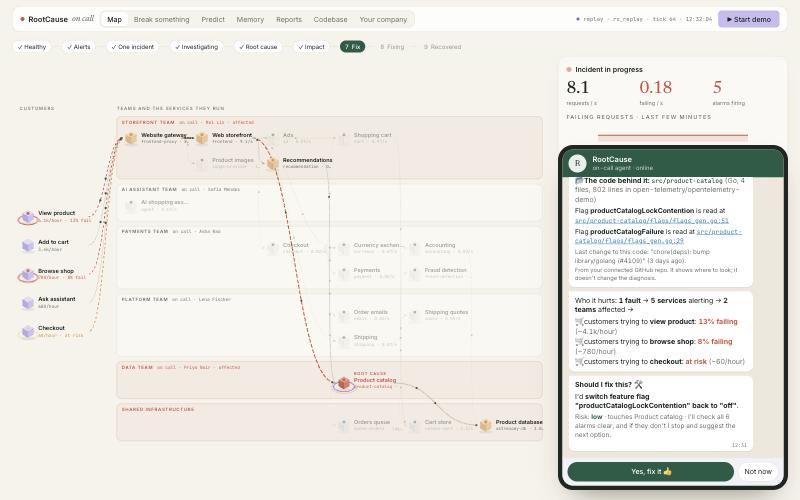
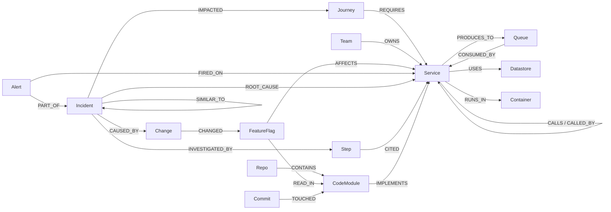

# RootCause

An AI on-call agent for the OpenTelemetry Demo shop. It turns live traces and metrics into a **FalkorDB** graph,
finds the one real cause behind a storm of symptom alerts, proves it with an evidence path, fixes it with human
approval, verifies recovery, writes the report and remembers the incident.

**Track:** Graph Hacks: Context for AI Agents (WeMakeDevs × FalkorDB) — *Agents That Act on Connected Data*
**Demo video:** _TODO: add YouTube link_ · **Live (replay) deployment:** http://3.234.90.242/ (AWS, replay mode — see [docs/DEPLOY.md](docs/DEPLOY.md))

Architecture diagram and how each part works: [docs/ARCHITECTURE.md](docs/ARCHITECTURE.md). Picking this up? Start with [HANDOFF.md](HANDOFF.md).



> Status (16 Oct 2026): acceptance checks M0–M7 pass against the real OpenTelemetry Demo, M8 (MCP) is verified with
> an MCP client; every catalogue fault was broken by hand and what RootCause saw is in
> [chaos/catalogue.yaml](backend/rootcause/chaos/catalogue.yaml). Evidence: [docs/PROGRESS.md](docs/PROGRESS.md).

## Why a graph
Many alerts → one incident is a **connected-components** question (`algo.WCC` over BLAMES). "Who is to blame" is
**PageRank** over BLAMES plus depth. "What else breaks" is **BFS** upstream over CALLED_BY. "How risky is a restart" is
**betweenness**. "Have we seen this before" is **Jaccard** over shared SignalPatterns. Remove FalkorDB and none of
these work — the graph is the engine's state, not a cache.

## Connect your GitHub
Paste a public repository URL in the **Codebase** tab. RootCause makes a shallow clone and reads it (it never runs
it) into the same graph: which folder `IMPLEMENTS` which service, what it `DECLARES` it depends on (compose
`depends_on`, `*_ADDR` env vars), gRPC services from `.proto` files, where each feature flag is `READ_IN` (file:line)
and the latest commits per module. During an incident the chat then shows the code behind the root cause, e.g.
*"Flag paymentFailure is read at src/payment/charge.js:40"*, and the agent's `read_code` step cites the module.
`code_drift` compares the declared dependencies with the calls seen live. The code explains; it never changes
the ranking. The public site scans only the official OpenTelemetry Demo repo (`code.allowed_repos`).

## Fix it in code (pull requests)
After an incident is fixed and verified, RootCause can also fix it **in the code**. It finds the file where the
root-cause service reads the flag that broke it (from the scanned repo), asks Claude for a small find/replace fix,
applies it only if every edit matches exactly once, and opens a **GitHub pull request** on our fork (`RC_PR_REPO`).
The PR description carries the evidence path, the change and the customer impact from the graph, and the PR is
recorded as `(:PullRequest)-[:FIXES]->(:Incident)`. It needs a human approval like every action, opens at most one
PR per 10 minutes, never merges, and says plainly that RootCause did not run the changed code. Needs
`ANTHROPIC_API_KEY`, `GITHUB_TOKEN` (fine-grained, the fork only) and `RC_PR_REPO`.

## Make it yours
RootCause learns the service graph from telemetry on its own. The **Your company** tab (or `config/seed.yaml`) adds
what only your company knows, stored as graph edges: `(:Team)-[:OWNS]->(:Service)` and on-call people (who gets
paged), `(:Journey)` routes (business impact) and `(:Runbook)-[:FOR]->(:Service)` with an optional **automation
URL** (a webhook to your own script or workflow, proposed as a fix with its declared risk and run only after
approval). Export the setup back to seed.yaml with one click.

## Quick start — live mode (needs Docker, ~8 GB RAM)
```bash
cp .env.example .env            # add ANTHROPIC_API_KEY to use the LLM agent (optional)
make demo-up                    # clones the OpenTelemetry Demo to ../opentelemetry-demo, installs our collector override,
                                # sets LOCUST_USERS=12 in its .env.override, starts agentic mode
make up                         # FalkorDB (:6380, browser :3300), API (:8000, OTLP :4318), MCP (:8811), UI (:8088)
make seed                       # indexes + teams, people, journeys, runbooks
open http://localhost:8088      # wait ~3 min while baselines are learned
```
Then go to **Chaos lab → Break it**, or from a terminal:
`uv run python scripts/acceptance_check.py --flag paymentFailure --approve` (flips the flag, prints the alert timeline,
the incident, evidence path and proposals, approves the fix and waits for verified recovery).

Notes from running it for real: the demo's default 5 load-generator users give checkout only ~2 requests/min, too few
for 60 s detection windows, so `make demo-up` raises `LOCUST_USERS` to 12 (the demo's own knob). Keep the laptop awake
and plugged in — a sleeping Mac pauses the Docker VM. `POST /api/admin/reset` gives a fresh graph (re-learns baselines).

Development without containers for the API: `uv sync && PYTHONPATH=backend uv run python -m rootcause.api` with
`FALKORDB_HOST=localhost FALKORDB_PORT=6380`; UI: `make ui` (Vite on :5173, proxies `/api` to :8000).

## Quick start — replay mode (no demo needed)
```bash
make replay-up                  # FalkorDB + API (RC_MODE=replay) + UI on :8088
open http://localhost:8088      # the healthy part fast-forwards, the fault plays live; approve the fix to see recovery
```
Recordings live in `replay/*.jsonl.gz` and are made from the live demo with `make record SCENARIO=paymentFailure`.

## Graph data model
Full tables: [docs/GRAPH_MODEL.md](docs/GRAPH_MODEL.md).



| Nodes | Service, Queue, Datastore, Container, Journey, Team, Person, Runbook, FeatureFlag, Change, Alert, Incident, SignalPattern, Hypothesis, Action, Prediction, Step, Report, ChaosRun, Repo, CodeModule, RpcService, Commit, PullRequest (+ dynamic `:Anomalous`) |
|---|---|
| **Edges** | CALLS, CALLED_BY, PRODUCES_TO, CONSUMED_BY, USES, RUNS_IN, REQUIRES, OWNS, MEMBER_OF, FOR, REMEDIATES, AFFECTS, CHANGED, FIRED_ON, PART_OF, BLAMES (transient), ROOT_CAUSE, CAUSED_BY, IMPACTED, RESOLVED_BY, HAS_SIGNAL, SIMILAR_TO, HAS_REPORT, HAS_HYPOTHESIS, INVESTIGATED_BY, NEXT, CITED, PREDICTS, PRODUCED, CONTAINS, IMPLEMENTS, DECLARES, SERVES, READ_IN, TOUCHED, FIXES, CHANGES |

## Queries and algorithms we depend on
All 102 queries are named `.cypher` files in [backend/rootcause/graph/queries/](backend/rootcause/graph/queries/), listed
with their purpose in [docs/QUERIES.md](docs/QUERIES.md). The core ones:

| Query | Algorithm | Purpose |
|---|---|---|
| [rebuild_blames](backend/rootcause/graph/queries/rebuild_blames.cypher) | – | BLAMES between anomalous nodes |
| [group_incidents](backend/rootcause/graph/queries/group_incidents.cypher) | `algo.WCC` | many alerts → one incident |
| [pagerank_blame](backend/rootcause/graph/queries/pagerank_blame.cypher) | `algo.pageRank` | where blame flows |
| [evidence_path](backend/rootcause/graph/queries/evidence_path.cypher) | `shortestPath` | the evidence chain |
| [upstream_bfs](backend/rootcause/graph/queries/upstream_bfs.cypher) | `algo.bfs` | blast radius, prediction |
| [service_betweenness](backend/rootcause/graph/queries/service_betweenness.cypher) | `algo.betweenness` | restart risk |
| [code_for_node](backend/rootcause/graph/queries/code_for_node.cypher) | – | the code behind the root cause (module, flag reads, commits) |
| [code_drift](backend/rootcause/graph/queries/code_drift.cypher) | – | calls seen live vs dependencies the repo declares |
| [similar_incidents](backend/rootcause/graph/queries/similar_incidents.cypher) | Jaccard over HAS_SIGNAL | incident memory |
| [recent_changes_for](backend/rootcause/graph/queries/recent_changes_for.cypher) | – | flag changes that AFFECT a node |

## Scorecard
Blind chaos runs on the live demo (`make chaos N=15`): the harness flips a random catalogue flag, the engine is not
told, and the settled verdict is scored against the catalogue truth, next to simple baselines on the same alerts.
Full table, per-class breakdown and every miss: [docs/SCORECARD.md](docs/SCORECARD.md) (copied below by
`scripts/sync_readme_scorecard.py`, never typed).

<!-- scorecard:start -->
15 blind chaos runs. Generated by `make chaos`; do not edit by hand. Every method is scored on the same alert snapshot; a run with no incident is a miss for every method.

| method | top-1 | top-3 | median time to verdict | runs scored |
|---|---|---|---|---|
| rootcause | 87% | 93% | 53 s | 15 |
| graph_off | 80% | 87% | - | 15 |
| llm_no_graph | - | - | - | 0 |
| loudest_alert | 40% | 80% | - | 15 |
| first_alert | 40% | 80% | - | 15 |
| highest_error | 40% | 87% | - | 15 |

## RootCause top-1 by fault class

| class | top-1 | runs |
|---|---|---|
| ai | 100% | 1 |
| errors | 100% | 6 |
| invisible | 67% | 3 |
| latency | 80% | 5 |

## Misses

- `kafkaQueueProblems` (truth `fraud-detection | checkout`): verdict `db:astronomy-db` — truth not among candidates (top-1 was db:astronomy-db)
- `productCatalogLockContention` (truth `product-catalog`): verdict `db:astronomy-db` — truth ranked 2 (top-1 was db:astronomy-db)
<!-- scorecard:end -->

## Use it from Claude Desktop (MCP)
With `make up` running, add to `claude_desktop_config.json`:
```json
{
  "mcpServers": {
    "rootcause": {
      "command": "uv",
      "args": ["run", "--directory", "/path/to/rootcause", "python", "-m", "rootcause.mcp_server"],
      "env": {"PYTHONPATH": "backend", "FALKORDB_HOST": "localhost", "FALKORDB_PORT": "6380",
              "RC_API_URL": "http://localhost:8000"}
    }
  }
}
```
Ask: *"Who owns payment?"*, *"What's the root cause of the open incident?"*. Tools: `list_incidents`,
`get_incident`, `rank_root_causes`, `trace_evidence_path`, `what_changed`, `measure_impact`, `blast_radius`,
`predict_failure`, `find_similar_incidents`, `who_owns`, `get_runbook`, `cypher_readonly`, `propose_action`,
`execute_action` (needs a human-minted approval token), `verify_recovery`, `write_report`.

## Tests
`make lint test` (unit + graph tests; graph tests start a FalkorDB test container and skip without Docker),
`make scenario-test` (golden replays: top-1 must equal the catalogue truth).

## Data statement
Only telemetry generated by the OpenTelemetry Demo on our own machines, plus the synthetic seed file
(`config/seed.yaml`: invented teams, people and runbooks). No private or scraped data.

## AI disclosure
Built with Claude Code; see [docs/AI_DISCLOSURE.md](docs/AI_DISCLOSURE.md).

## Team
- **Yash Aggarwal** — live integration with the OpenTelemetry Demo, detection fixes from the real runs, chaos
  evaluation, replay deployment on AWS, docs and video.
- **Shambhvi** — original design and implementation of every milestone: graph model and queries, ingest, engine,
  actions, agent and MCP server, UI.

_Both: edit this section to match who did what before submitting._
