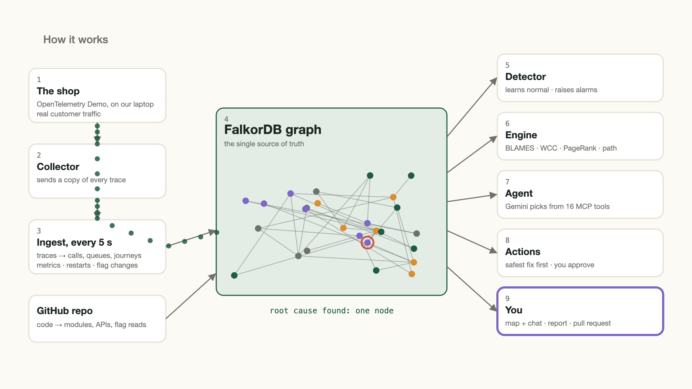

# Four alarms, one cause: building an AI on-call engineer on a graph

*Draft for the Graph Hacks "best blog post" side prize. Images are in `docs/img/`; publish on Hashnode, dev.to or
Medium with the images uploaded.*

It's 3 AM. Four alarms go off: the website gateway, the storefront, checkout and payment. Two teams get paged.
Every alarm is real. But only one service is actually broken, and the other three are failing because they depend on
it. Working out which one, by hand, under pressure, is the slowest part of every outage.

We built **RootCause** for Graph Hacks (WeMakeDevs × FalkorDB; Track 01: Agents That Act on Connected Data, and Track 03: Company Brain). It
watches a real shop, turns everything it sees into a FalkorDB graph, and lets an AI agent find the cause, prove it,
fix it with a person's approval, and open the code fix as a pull request.

## The problem is a graph problem

When we wrote down the questions an on-call engineer asks during an outage, every one of them turned out to be about
connections:

- *Which of these alarms belong together?* That's connected components.
- *Where does the blame flow?* PageRank over "who fails because of whom".
- *What's the proof?* A shortest path from the customer to the cause.
- *What would a restart touch?* A breadth-first search upstream, plus betweenness centrality for risk.
- *Have we seen this before?* Overlap of signal patterns between incidents.

A table of alerts can't answer these. A graph answers each one with a single query. So FalkorDB isn't a cache next
to our app: it *is* the app's state. Take it away and nothing groups, ranks, proves, predicts or remembers.

## What goes into the graph

We used the official **OpenTelemetry Demo**, a real online shop with about twenty services, a load generator,
Kafka, Postgres and feature flags that inject real faults. One extra exporter in its collector sends us a copy of
every trace. Every five seconds RootCause turns them into:

- `(:Service)-[:CALLS {rps, err_rate, p95}]->(:Service)`, plus queues, datastores and containers,
- customer journeys: `(:Journey)-[:REQUIRES]->(:Service)`,
- changes: every feature-flag switch and container restart becomes a `(:Change)`,
- what only a company knows: teams, on-call people, runbooks.

Then we connect the shop's GitHub repo, and the code goes into the same graph: which folder `IMPLEMENTS` which
service, the gRPC APIs it `SERVES`, the dependencies it `DECLARES`, and every line where a feature flag is `READ_IN`.
A graph join even shows *drift*: calls seen in live traffic that the code never declares.

## Finding the cause

When alarms fire, the nodes get an `:Anomalous` label and we draw `BLAMES` edges between anomalous neighbours along
the failing calls. `algo.WCC` turns the blamed nodes into one incident, so four pages become one. Each suspect gets a
score from five signals: is it at the bottom of the blame chain, are its own requests failing, where does PageRank put
the blame, did something change on it just before, and was it the cause last time. Two general rules handle the
tricky cases. If a caller keeps calling a service that has no traffic at all, the broken thing is the connection. A
database that didn't change is a symptom, not a cause.

Never cheating was a hard rule for us: the engine never reads the flag configuration to decide a cause. The flags
are only used afterwards, to score our blind tests.

## An agent that works the graph

A Gemini agent investigates through 16 tools on our MCP server: rank the suspects, trace the evidence path, check
what changed, measure the impact, find who's on call. Every tool call is a graph query, and every step is saved as a
`(:Step)` node linked to the nodes it cited, so the reasoning trail is itself part of the graph. The agent may only
state facts its tools returned, and it can't run anything: every action needs a single-use approval token that only
a person can create.

## Acting, safely

The agent proposes the safest fix first. For a bad flag that's switching it back: low risk. A restart is judged with
the graph too. BFS finds everything upstream, betweenness says how central the service is, and a service that keeps
state is marked high risk and needs typed confirmation. After the fix, RootCause watches every alarm and only marks
the incident resolved when all of them stay clear. Then it writes the report and remembers the incident's
fingerprint, so next time it can suggest the fix that worked first.

## Fixing it in the code

Switching the flag off stops the bleeding, but the risky code is still there. So RootCause offers a code fix. It
fetches the exact file from GitHub (it knows which one from the code layer), Gemini writes a small change, and
RootCause opens a real pull request on our fork, with the graph's evidence in the description: the root cause, the
blame path, the change and the customer impact. It never merges anything itself. In our demo run a person read the
diff and merged it.

## Did it work?

We tested it blind: a harness switches on one of 16 real faults at random, doesn't tell RootCause, and scores the
answer by code afterwards. In the latest batch of 15, RootCause named the cause first 80% of the time. Blaming the
loudest alarm got 53%. Gemini given only a flat table of the same alarms also got 80%, but on different runs: it
missed the broken network connection that only the graph could see, and of course it can't prove its answer, judge
the risk or fix anything. We publish the misses too. All three of ours were faults where the real cause never raised
an alarm.

## What we learned

- **Model the questions first.** Once each question was a graph query, the agent's job became choosing which
  question to ask, which is exactly what tool selection over MCP is good at.
- **Keep the agent honest with the graph.** Citing node ids and saving every step made the agent's answers checkable.
- **Measure against simple baselines.** "Blame the loudest alarm" is a surprisingly strong baseline. Beating it, and
  being honest when an LLM without the graph ties, made the results more useful than a single big number.
- **Real systems are messy.** Sparse traffic, partial faults and noisy neighbours taught us more than any synthetic
  data could.

Try the replay at **http://3.234.90.242/** (click *Start demo*), and read the code at
**https://github.com/rootcause-1/rootcause**.

*We used Claude Code as an AI coding assistant while building RootCause; the disclosure is in the repo.*
