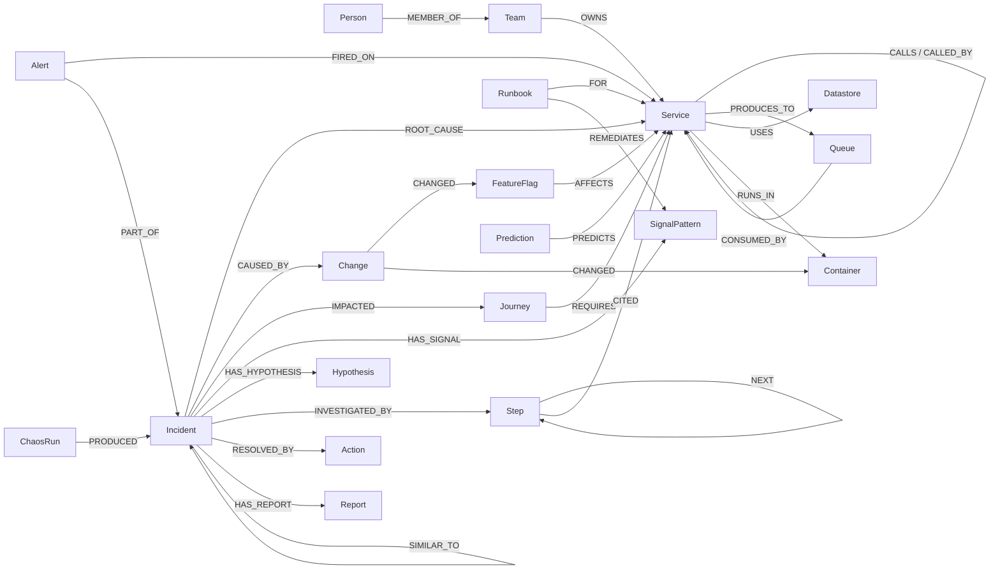

# Graph model

FalkorDB multigraph. One graph per purpose, selected with `RC_GRAPH`, never mixed:
`rc_live` (live demo), `rc_replay` (public deployment), `rc_eval_<batch>` (chaos runs and tests).

Conventions: every node has a string `id` with an index (`CREATE INDEX FOR (n:Label) ON (n.id)`); times are epoch
**milliseconds**; rates are per second; percentages are 0–1 floats. Ids are unique across labels:
services use the OTel `service.name` (`payment`), queues `queue:orders`, datastores `db:<name>` / `cache:<host>`,
journeys `journey:checkout`, incidents `INC-0001`, alerts `ALT-<uuid8>`, changes `CHG-<uuid8>`, actions `ACT-<uuid8>`.

## Nodes

| Label | Key properties | Written by |
|---|---|---|
| Service | rps, err_rate, op_err_rate (worst route), self_err_rate, p95_ms, op_p95_ms (slowest route), server_spans (server + consumer spans), cpu_pct, mem_mb, mem_slope, gc_frac (JVM time in GC), runtime_mem_mb, tool_calls_per_run, llm_p95_ms, `bl_*` baselines, `hit_*`/`ok_*`/`nd_*` rule counters, last_seen | ingest, Prometheus, docker stats, detector |
| Queue | produce_rate, consume_rate, lag, lag_slope, `bl_*` | ingest (spans + Prometheus) |
| Datastore | system, rps, err_rate, p95_ms | ingest (db client spans) |
| Container | cpu_pct, mem_mb, mem_slope | docker stats |
| Journey | name, routes, success_rate, rps, bl_success_rate | seed + ingest |
| Team, Person | name; Person.on_call, contact | seed |
| Runbook | title, url, steps | seed |
| FeatureFlag | variant (effective: `defaultVariant` or the targeting on-branch), baseline_variant (at first observation) | flag watcher, span flag evaluations, seed map |
| Change | kind (flag/restart/die), from_variant, to, ts, actor (unknown/rootcause/harness) | flag watcher, docker events |
| Alert | kind, target, value, threshold, baseline, dev, ts, status, resolved_ts | detector |
| Incident | status, members, created_ts, onset_ts, root_target, confidence, agent_state, verdict (JSON), ttr_ms, resolution | engine, agent, verify |
| SignalPattern | id = `<node>:<kind>` | detector, seed |
| Hypothesis | target, score, rank, depth, self, pagerank, change, memory | engine |
| Action | incident_id, kind, target, params, risk, side_effects, status, approval_hash, approval_expires | action service |
| Prediction | services, queues, journeys, precision, recall | predict |
| Step | n, tool, args, summary, ts | agent |
| Report | markdown, path, ts | report |
| ChaosRun | flag, variant, truth, class, verdict, top1, top3, ttd_ms, results, seed | chaos runner (eval graph only) |
| Repo | url, sha, scanned_ts | codebase scan (`codebase/store.py`) |
| CodeModule | id `code:<name>`, name, path, language, files, loc, owners (CODEOWNERS), kind (code/image) | codebase scan |
| RpcService | name, methods, file | codebase scan (.proto) |
| Commit | id = sha, ts, subject (no author names) | codebase scan (`git log` per module) |
| PullRequest | id = url, number, branch, title, ts | fix it in code (`codebase/fix.py`) |

Dynamic label: anomalous Service/Queue/Datastore nodes also carry **`:Anomalous`** (set by `create_alert`,
removed by `resolve_alert` when no firing alert remains).

## Relationships

| Relationship | Properties | Notes |
|---|---|---|
| `(Service)-[:CALLS]->(Service)` | protocol, rps, err_rate, p95_ms, unanswered_rate, unanswered_share, baseline_err, baseline_p95, last_seen | from paired client/server spans (callee named from `rpc.method` when unanswered) |
| `(Service)-[:CALLED_BY]->(Service)` | protocol, rps, err_rate, last_seen | mirror of CALLS, same query; used by `algo.bfs` upstream walks |
| `(Service)-[:PRODUCES_TO]->(Queue)` | rate | producer spans |
| `(Queue)-[:CONSUMED_BY]->(Service)` | rate, group, last_seen | consumer spans |
| `(Service)-[:USES]->(Datastore)` | rps, err_rate, p95_ms | db client spans |
| `(Service)-[:RUNS_IN]->(Container)` | | docker stats |
| `(Journey)-[:REQUIRES]->(Service)` | share, critical | services seen in a journey's traces |
| `(Team)-[:OWNS]->(Service)`, `(Person)-[:MEMBER_OF]->(Team)` | | seed |
| `(Runbook)-[:FOR]->(Service)`, `(Runbook)-[:REMEDIATES]->(SignalPattern)` | | seed |
| `(FeatureFlag)-[:AFFECTS]->(Service)` | source (`spans`), last_seen | `feature_flag.evaluation` span events (services that evaluate the flag); seed map as fallback |
| `(Change)-[:CHANGED]->(FeatureFlag \| Container)` | | |
| `(Alert)-[:FIRED_ON]->(node)`, `(Alert)-[:PART_OF]->(Incident)` | | |
| `(a)-[:BLAMES]->(b)` | weight | **transient**, rebuilt every tick between `:Anomalous` nodes |
| `(Incident)-[:ROOT_CAUSE]->(node)` | edge (for `edge:A->B` causes), score | |
| `(Incident)-[:CAUSED_BY]->(Change)`, `-[:IMPACTED {pct}]->(Journey)`, `-[:RESOLVED_BY]->(Action)`, `-[:HAS_SIGNAL]->(SignalPattern)`, `-[:SIMILAR_TO {score}]->(Incident)`, `-[:HAS_REPORT]->(Report)`, `-[:HAS_HYPOTHESIS]->(Hypothesis)`, `-[:INVESTIGATED_BY]->(Step)` | | |
| `(Step)-[:NEXT]->(Step)`, `(Step)-[:CITED]->(any)` | | agent trail |
| `(Prediction)-[:PREDICTS]->(Service \| Queue \| Journey)`, `(ChaosRun)-[:PRODUCED]->(Incident)` | | |
| `(Repo)-[:CONTAINS]->(CodeModule)`, `(CodeModule)-[:IMPLEMENTS]->(Service \| Datastore)` | | codebase scan; IMPLEMENTS matched by name |
| `(CodeModule)-[:DECLARES]->(CodeModule)` | via (`depends_on` or the env var) | compose files; compared with CALLS in `code_drift` |
| `(CodeModule)-[:SERVES]->(RpcService)`, `(Commit)-[:TOUCHED]->(CodeModule)` | | .proto files, git log |
| `(FeatureFlag)-[:READ_IN]->(CodeModule)` | file, line | where the code reads a flag. Explanation only, never a ranking input |
| `(PullRequest)-[:FIXES]->(Incident)`, `(PullRequest)-[:CHANGES]->(CodeModule)` | | the fix PR RootCause opened |
